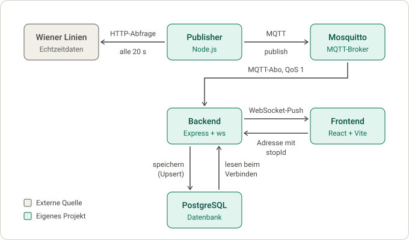

# ÖV-Mini-Simulation

Ein Lernprojekt zu Echtzeitdaten im öffentlichen Verkehr: Die aktuellen Abfahrten der Wiener Linien werden über MQTT (ein leichtgewichtiges Nachrichtenprotokoll) und den Broker Mosquitto an das Backend geschickt, in PostgreSQL gespeichert und per WebSocket live im Browser angezeigt. Der Schwerpunkt liegt auf MQTT und der Verarbeitung von Echtzeitdaten. Zu sehen sind zehn ausgewählte Haltepunkte rund ums Volkstheater und Parlament.

## 1. Architektur



### 1.1 Ablauf im Einzelnen

1. Der Publisher fragt alle 20 Sekunden die Wiener Linien ab (eine gemeinsame HTTP-Anfrage) und veröffentlicht pro Haltepunkt eine Nachricht auf `oev/wien/haltestelle/<RBL>/abfahrten` (QoS 1, *retained*).
2. Mosquitto leitet sie an das Backend weiter. Das Backend hat das Topic `oev/wien/haltestelle/+/abfahrten` mit QoS 1 abonniert. Da die Nachrichten *retained* sind, bekommt es beim Start sofort den letzten Stand jedes Haltepunkts.
3. Das Backend validiert die Nachricht und speichert sie per Upsert in PostgreSQL (eine Zeile pro RBL, die Zeile wird überschrieben). Nur wenn das Speichern gelingt, geht es weiter.
4. Es schickt die Daten per WebSocket an alle Clients, die diesen Haltepunkt abonniert haben.
5. Das Frontend öffnet pro Haltepunkt eine WebSocket-Verbindung (`/ws?stopId=<RBL>`). Beim Verbinden liest das Backend den letzten Stand aus PostgreSQL und sendet ihn sofort, danach folgt jedes Update. Bricht die Verbindung ab, versucht das Frontend es nach 3 Sekunden erneut. Das geschieht nicht, wenn das Backend die Verbindung wegen einer ungültigen `stopId` schließt (Code 1008, Hinweis „Ungültige Haltestelle“) oder wenn das Frontend sie selbst beendet hat.

### 1.2 Komponenten

| Komponente | Ordner / Datei | Aufgabe |
|---|---|---|
| Publisher | `publisher/` | Holt alle 20 s die Abfahrten (max. 2 pro Linie) und veröffentlicht sie pro Haltepunkt als *retained* MQTT-Nachricht (QoS 1) auf `oev/wien/haltestelle/<RBL>/abfahrten`. Enthält die Datenquellen (Wiener Linien oder Fake-Daten) und den MQTT-Publisher. |
| Mosquitto | `mosquitto/` | MQTT-Broker mit Login und ACL: `publisher` darf nur schreiben, `backend` nur lesen. Enthält die Broker-Konfiguration und die ACL-Vorlage. |
| Backend | `backend/` | Abonniert die Topics, validiert Nachrichten, speichert den letzten Stand je RBL in PostgreSQL (Upsert) und sendet ihn per WebSocket an interessierte Clients. Bietet zusätzlich eine REST-API. Enthält Express-Server, MQTT-Subscriber, WebSocket-Server und PostgreSQL-Zugriff. |
| PostgreSQL | `db/init/` | Tabelle `monitors` (`rbl`, `title`, `payload` als JSONB, `received_at`), wird beim ersten Start automatisch angelegt. Der Ordner enthält die SQL-Skripte für die Erstinitialisierung. |
| Frontend | `frontend/` | React + Vite + Bootstrap. Haltepunkt-Suche, Mehrfachansicht für mehrere Haltepunkte, Live-Aktualisierung per WebSocket. |
| Daten | `data/` | Haltepunkt-Stammdaten (`haltepunkte.csv`) und Liste der Echtzeit-Haltepunkte (`echtzeit-haltepunkte.json`). |
| Docker Compose | `docker-compose.yml` | Startet Mosquitto und PostgreSQL. |

Begriffe: **RBL** = Rechnergestütztes Betriebsleitsystem-Nummer, die ID eines Haltepunkts (einer Steig-/Richtungsposition) in den Wiener-Linien-Daten.

### 1.3 Schnittstellen des Backends (Port 3000)

| Endpunkt | Beschreibung |
|---|---|
| `GET /api/health` | Lebenszeichen, `{ "status": "ok" }` |
| `GET /api/stops` | Liste der unterstützten Haltepunkte (`rbl`, `title`), nach Name sortiert |
| `GET /api/departures/:stopId` | Letzter gespeicherter Stand eines Haltepunkts (400 bei ungültiger ID, 404 wenn unbekannt) |
| `WS /ws?stopId=<RBL>` | Sendet sofort den aktuellen Stand und danach bei jeder neuen MQTT-Nachricht ein Update |

Eingehende MQTT-Nachrichten werden validiert (nicht leer, max. 256 KB, gültiges JSON, `rbl` im Payload stimmt mit dem Topic überein, `title` vorhanden); ungültige Nachrichten werden verworfen und geloggt.

## 2. Datenquelle

Echtzeitdaten der **Wiener Linien** (Open Government Data, Lizenz CC BY, Datenherkunft: Stadt Wien – [data.wien.gv.at](https://data.wien.gv.at), [wienerlinien.at/open-data](https://www.wienerlinien.at/open-data)).

- Die Antwort wird im Originalformat der Monitor-API weitergereicht, nur mit höchstens zwei Abfahrten pro Linie statt zehn.
- Es erfolgt **eine einzige Anfrage für alle Haltepunkte**, um das Abfragelimit der Wiener Linien (Code 316) nicht zu erreichen.
- Jede Datenquelle erfüllt den Vertrag `DataSource` (`publisher/src/data-source.js`): `getMessages()` liefert pro RBL eine Nachricht. Zwei Implementierungen existieren:
  - `publisher/src/wienerlinien.js`: echte Daten (Standard)
  - `publisher/src/fake-daten.js`: Testdaten ohne Internet und ohne Limit. Zum Aktivieren in `publisher/src/index.js` den Import von `wienerLinienDataSource` durch die Fake-Quelle ersetzen.

### 2.1 Unterstützte Haltepunkte (bewusst fest hinterlegt)

Der Publisher fragt nur ein **fest hinterlegtes Set von 10 Haltepunkten (RBL)** ab. Die Liste steht in [`data/echtzeit-haltepunkte.json`](data/echtzeit-haltepunkte.json) (Feld `rbls`). Publisher (`publisher/src/wienerlinien.js`) und Backend (`backend/src/stop-list.js`, filtert `GET /api/stops`) lesen dieselbe Datei, die Liste wird also nur an einer Stelle gepflegt. Weitere Haltepunkte lassen sich dort eintragen (Namen stehen in `data/haltepunkte.csv`).

Gründe für die Entscheidung:

- Der Fokus des Prototyps liegt auf dem MQTT-Ablauf (Publisher, Broker, Subscriber) und dem Abruf echter Echtzeitdaten, nicht auf der Abdeckung des gesamten Netzes.
- Alle ca. 5100 Haltepunkte ständig abzufragen ist nicht möglich: Die Schnittstelle hat ein Abfragelimit, und empfohlen ist ein Mindestabstand von 15 Sekunden zwischen Abfragen (laut Drittquelle, nicht offiziell bestätigt).
- Ein bedarfsgesteuerter Abruf (siehe [Ausblick](#9-ausblick)) bräuchte Umbauten an Backend, Publisher und Mosquitto-Rechten und lenkt vom Lernziel ab.

`data/haltepunkte.csv` ist die Stammdatenliste aller Haltepunkte (Wiener Linien OGD) und dient dem Backend für `GET /api/stops`.

#### 2.1.1 Warum Volkstheater / Parlament

Ein großer Knoten, an dem alle drei Fahrzeugarten halten (geprüft am 2026-11-08 gegen `https://www.wienerlinien.at/ogd_realtime/monitor?stopId=<RBL>`):

| RBL | Linien | Fahrzeug |
|---|---|---|
| 4206 | U2 (Richtung Aspernstraße, Seestadt) | U-Bahn |
| 4209 | U2 (Richtung Karlsplatz) | U-Bahn |
| 4908 | U3 (Richtung Ottakring) | U-Bahn |
| 4909 | U3 (Richtung Simmering) | U-Bahn |
| 1401 | 48A (Richtung Klinik Penzing) | Bus |
| 1440 | 49 (Richtung Hütteldorf, Bujattigasse) | Straßenbahn |
| 1482 | 48A und 49 | Bus und Straßenbahn |
| 1375 | 46, 48A und 49 | Bus und Straßenbahn |
| 15 | 1, 2, 71, D | Straßenbahn |
| 49 | 1, 2, 71, D | Straßenbahn |

Die Haltepunkte gehören zu den Haltestellen 60201430 (Volkstheater) und 60200246 (benachbarte Ringhaltestelle, „Parlament, U Volkstheater“). Bewusst weggelassen wurden 33, 3730, 4701, 2682, 5692, 1400 und 8226: Sie melden „OK“, liefern aber keine Linien. RBL 2682 ist in der CSV ein Platzhalter (keine DIVA-Nummer, Koordinaten 0).

#### 2.1.2 Abfrage im Publisher

- **Eine einzige Anfrage für alle Haltepunkte:** `.../monitor?stopId=15&stopId=49&...`. Mit zehn Einzelanfragen pro Runde (alle 20 Sekunden) antworteten die Wiener Linien nach wenigen Runden mit HTTP 403 und `{"message":{"value":"Abfragelimit erreicht!","messageCode":316}}`. Das genaue Limit ist nicht bekannt, die offizielle Dokumentation war nicht abrufbar. Mit der gemeinsamen Anfrage liefen 13 Runden in Folge fehlerfrei.
- Die Antwort enthält **einen „Monitor“ pro Linie und Haltepunkt** (z. B. vier Monitore für RBL 15 wegen der Linien 1, 2, 71 und D). Der Publisher fasst sie nach RBL zusammen und sendet pro RBL eine Nachricht im Originalformat (`data.monitors` und `message`).
- Je Linie höchstens zwei Abfahrten (statt bis zu zehn).
- Timeout der Anfrage: 10 Sekunden, kleiner als das Abfrageintervall von 20 Sekunden.
- Schlägt die Anfrage fehl, loggt der Publisher Status, `Retry-After` und den Anfang der Antwort; die nächste Runde startet normal. Fehlt ein Haltepunkt in der Antwort, steht „Keine Monitordaten für Haltestelle …“ im Log.

---

## 3. Voraussetzungen

- Node.js ≥ 20.6 (wegen `--env-file`; Projekt nutzt ES-Module). Entwickelt und getestet mit Node.js v26.13.0 (über nvm) unter Ubuntu in WSL.
- Docker und Docker Compose (je nach Installation mit `sudo`)

Technologien: Node.js, Express 5, `mqtt`, `ws`, `pg` (Backend und Publisher); Eclipse Mosquitto 2 und PostgreSQL 16 (Docker Compose); React 19, Vite 8 und React Bootstrap (Frontend).

## 4. Einrichtung

### 4.1 Umgebungsvariablen

```bash
cp .env.example .env
```

In `.env` Werte setzen: `MQTT_PUBLISHER_PASSWORD`, `MQTT_BACKEND_PASSWORD`, `POSTGRES_DB`, `POSTGRES_USER`, `POSTGRES_PASSWORD`. Die `.env` ist in `.gitignore` und darf nicht eingecheckt werden.

### 4.2 Mosquitto-Zugang anlegen

Die Dateien `mosquitto/config/passwd` und `mosquitto/config/acl` sind nicht im Repository (`.gitignore`).

```bash
cp mosquitto/config/acl.example mosquitto/config/acl
```

Passwortdatei erzeugen (die Passwörter müssen zu `.env` passen). Das Passwort-File muss vor dem ersten Start existieren:

```bash
docker run --rm -it -v "$PWD/mosquitto/config:/mosquitto/config" eclipse-mosquitto:2 \
  mosquitto_passwd -c /mosquitto/config/passwd publisher
```

```bash
docker run --rm -it -v "$PWD/mosquitto/config:/mosquitto/config" eclipse-mosquitto:2 \
  mosquitto_passwd /mosquitto/config/passwd backend
```

### 4.3 Broker und Datenbank starten

```bash
docker compose --env-file .env up -d
```

Mosquitto lauscht auf `127.0.0.1:1883`, PostgreSQL auf `127.0.0.1:5432` (beide nur lokal erreichbar). Das Init-Skript `db/init/001-create-monitors.sql` läuft nur beim ersten Start mit leerem Volume.

### 4.4 Abhängigkeiten installieren

```bash
(cd backend && npm install)
(cd publisher && npm install)
(cd frontend && npm install)
```

## 5. Starten

Jeweils in einem eigenen Terminal, vom Projektverzeichnis aus. Backend und Publisher lesen ihre Konfiguration aus Umgebungsvariablen. Sie werden daher mit `--env-file` gestartet (alternativ lädt man die `.env` vorher in die Shell mit `set -a; . ./.env; set +a`, sonst fehlt z. B. `POSTGRES_PASSWORD`).

```bash
cd backend && node --env-file=../.env --watch src/index.js
```

```bash
cd publisher && node --env-file=../.env src/index.js
```

```bash
cd frontend && npm run dev
```

Das Frontend läuft dann unter der von Vite angezeigten Adresse (Standard: <http://localhost:5173>). Der Vite-Dev-Server leitet `/api` und `/ws` an das Backend auf Port 3000 weiter.

## 6. Bedienung des Frontends

- **Startseite ohne Parameter:** zeigt die Abfahrten aller 10 Haltepunkte.
- **Ein oder mehrere Haltepunkte per URL:** `http://localhost:5173/?stopId=15` oder `?stopId=1375&stopId=15&...`. Ungültige oder doppelte `stopId` werden ignoriert, unbekannte Haltepunkte werden mit einem Hinweis ausgeschlossen („Diese Haltestellen gibt es nicht und werden nicht angezeigt: …“).
- **Suchfeld (Combobox):** wählt genau einen Haltepunkt. Treffer am Wortanfang stehen zuerst, Bedienung mit Pfeiltasten, Enter und Esc, höchstens 100 Treffer. Ein leeres Suchfeld führt zurück zur Gesamtansicht.
- **Anordnung:** eine Karte pro Linie und Richtung, sortiert nach Linienname (numerisch: 1, 2, 46, 48A, 49, 71, D, U2, U3), beide Richtungen einer Linie direkt untereinander. Jede Karte nennt zusätzlich den Haltepunkt (Titel und RBL), weil dieselbe Linie in derselben Richtung an zwei Haltepunkten vorkommen kann (z. B. die 49 bei RBL 1375 und 1440).

## 7. Hinweise und bewusst Weggelassenes

Das Projekt ist ein Lernprototyp für den eigenen Rechner, nicht für den Produktivbetrieb.

- **Netzwerk:** Mosquitto und PostgreSQL sind nur an `127.0.0.1` gebunden. Der Broker verlangt Login (`allow_anonymous false`); die ACL erlaubt dem Publisher nur Schreiben, dem Backend nur Lesen.
- **Topics:** Die MQTT-Topics sind bewusst deutsch und folgen dem Schema `oev/wien/haltestelle/<RBL>/abfahrten`. Das Backend verwirft Nachrichten, deren Topic nicht diesem Schema entspricht.
- **Keine Verschlüsselung:** Es gibt kein HTTPS und kein TLS für MQTT und WebSocket. Für einen öffentlichen Betrieb wären ein Reverse Proxy mit HTTPS und TLS am Broker nötig.
- **Vite-Proxy:** Der Proxy für `/api` und `/ws` in `frontend/vite.config.js` gilt nur für den Entwicklungsserver (`npm run dev`). Für einen Produktions-Build (`npm run build`) muss ein Webserver diese Weiterleitung übernehmen.
- **WebSocket:** Das Backend prüft die Herkunft (`Origin`) der Verbindung bisher nicht.
- **Zugangsdaten:** Passwörter stehen nur in `.env` und in `mosquitto/config/passwd`, beide sind nicht im Repository.
- **Abhängigkeiten:** `npm audit` meldet 4 Meldungen mittlerer Schwere in Entwicklungsabhängigkeiten. Sie betreffen nur die Entwicklung; ein `npm audit fix --force` wurde bewusst nicht ausgeführt.
- **Testdaten:** Wurden zuvor die Fake-Daten (`publisher/src/fake-daten.js`) verwendet, können alte Zeilen (RBL 252 und 9001) in der Tabelle `monitors` liegen. Sie werden vom Frontend nicht angezeigt, sind aber über `GET /api/departures/<RBL>` abrufbar.

## 8. Bekannte Einschränkungen des Prototyps

- Das Dropdown bietet nur die 10 Haltepunkte aus `data/echtzeit-haltepunkte.json` an (das Backend filtert `GET /api/stops`). Der Mechanismus (Dropdown, Prüfung der `stopId`) bleibt bestehen, damit später mit bedarfsgesteuertem Abruf wieder die ganze Liste angeboten werden kann.
- Namensfalle in der CSV: Haltepunkte mit dem Namen „Volkstheater U“ sind die oberirdischen (Bus, Straßenbahn), die mit dem Namen „Volkstheater“ sind die U-Bahn-Steige.
- Die CSV enthält 32 Platzhalterzeilen ohne Namen, die beim Laden übersprungen werden.
- Das Frontend öffnet für mehrere Haltepunkte pro Haltepunkt eine eigene WebSocket-Verbindung. Für einen Prototyp auf dem eigenen Rechner ist das in Ordnung.

## 9. Ausblick

**Bedarfsgesteuerter Abruf** für die gesamte Liste:

1. Das Backend merkt sich, für welche Haltestellen gerade WebSocket-Zuschauer verbunden sind.
2. Es veröffentlicht diese Liste auf einem eigenen Steuer-Topic (z. B. unter `oev/wien/steuerung/...`).
3. Der Publisher abonniert das Steuer-Topic und fragt nur die gewünschten Haltestellen ab; ohne Zuschauer endet die Abfrage nach einer Frist.
4. Mosquitto-ACL: Der Publisher darf das Steuer-Topic lesen, das Backend darf darauf schreiben.
5. Eine Obergrenze für gleichzeitig abgefragte Haltestellen verhindert das Erreichen des Abfragelimits.
6. Folge: Nach dem Öffnen einer Haltestelle dauert es bis zur ersten Anzeige bis zu eine Abfragerunde (etwa 20 Sekunden).

**Mehrfachansicht:** Eleganter als mehrere Verbindungen wäre eine einzige WebSocket-Verbindung, die mehrere `stopId` annimmt.

## 10. Lizenz und Datenhinweis

Die Abfahrts- und Haltepunktdaten stammen von den Wiener Linien bzw. der Stadt Wien und stehen unter CC BY. Bei Weiterverwendung ist die Quelle „Datenquelle: Stadt Wien – data.wien.gv.at“ anzugeben. Der Quellenhinweis steht im Frontend (`PageLayout.jsx`), im Code (`stop-list.js`, `wienerlinien.js`) und hier.
